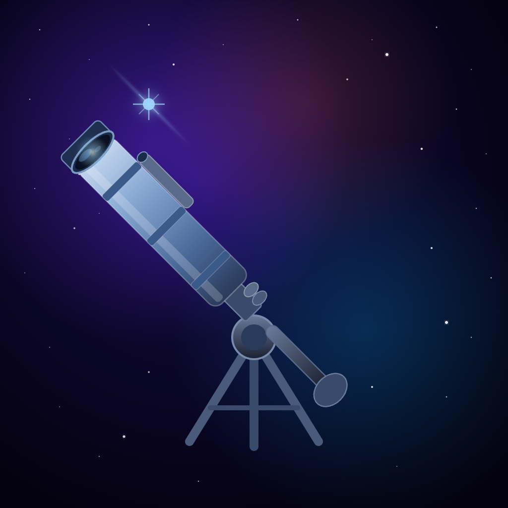

# Nastromy

  

**Nastromy** is an iOS app for exploring NASA's Astronomy Picture of the Day (APOD).

Browse stunning space imagery updated daily — from distant galaxies to our own solar system — with explanations written by professional astronomers.

---

## Features

- **Daily APOD** — the latest NASA Astronomy Picture of the Day loads automatically
- **Full history** — scroll back through 30+ years of APOD entries dating to 1995
- **Explore** — browse a curated grid of recent photos
- **Favorites** — save photos to revisit later
- **Detail view** — full-screen image with explanation, copyright, and date
- **Appearance** — choose Light, Dark, or follow the system setting
- **Daily reminder** — optional notification at a time you choose
- **Text-to-Speech** — hear the APOD explanation read aloud
- **Pull-to-refresh** — always get the latest photo

---

## Requirements

- iOS 26.0 or later
- iPhone (iPad support planned)

---

## Data & Privacy

Nastromy fetches photo data from [NASA's APOD service](https://science.nasa.gov). No personal data is collected, stored, or transmitted. See [PRIVACY.md](PRIVACY.md) for full details.

---

## Legal

- [Privacy Policy](PRIVACY.md)
- [Terms of Use](TERMS.md)
- [Support](SUPPORT.md)

---

## Contact

nastromyapp@gmail.com

---

*Made with ❤️ in Stockholm 🇸🇪*
